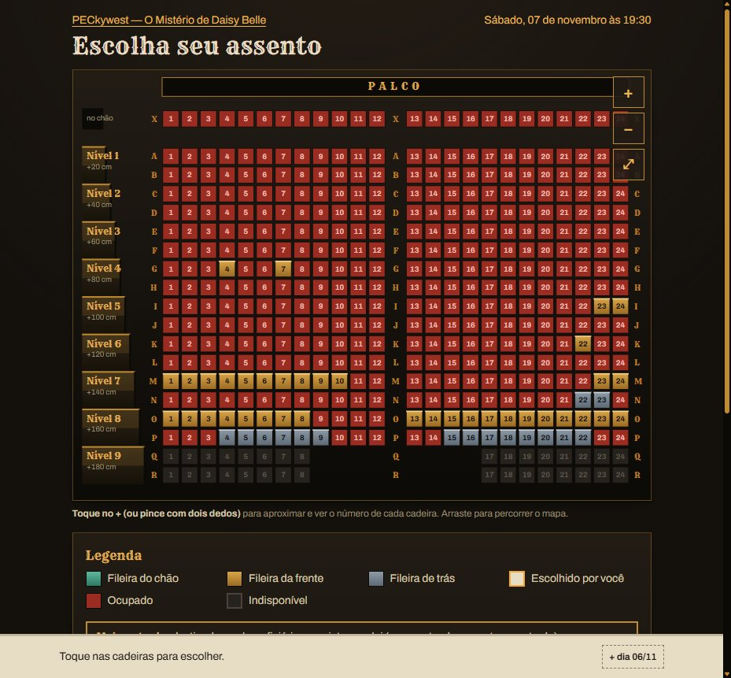
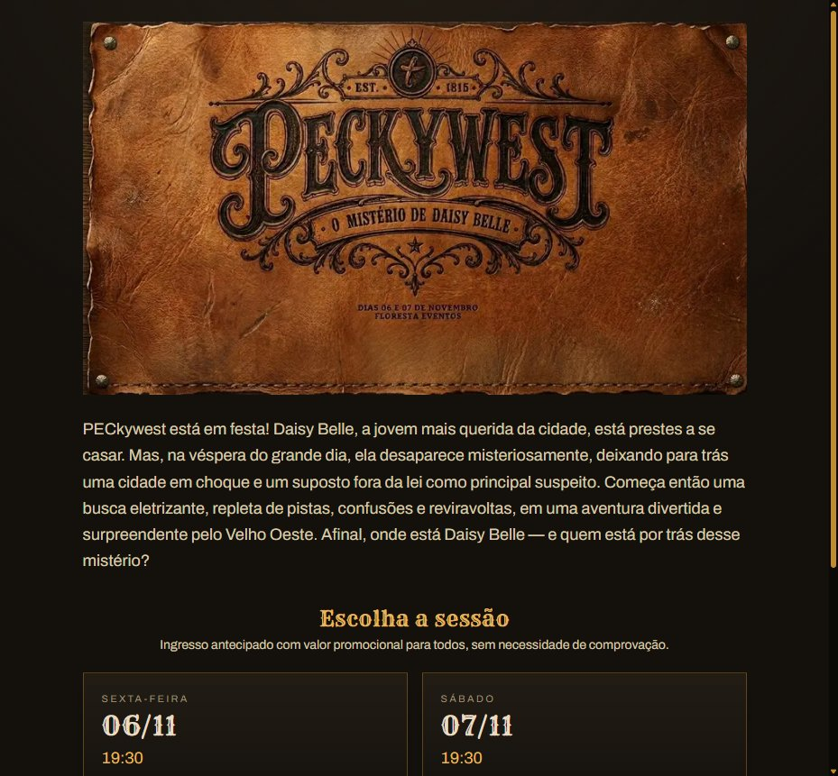

# PEC Ingressos

**Sistema próprio de venda de ingressos com mapa de assentos, Pix e cartão, ingresso com QR e check-in na portaria. Em produção: cerca de 680 ingressos vendidos para as duas sessões do espetáculo de uma escola de dança em Sorocaba (SP).**



<sub>Mapa da sessão de 07/11/2026 no dia do espetáculo: em vermelho, os lugares já vendidos.</sub>

## O problema

A PEC Studio, escola de dança em Sorocaba desde 2015, faz espetáculos num teatro de cerca de 600 lugares. As plataformas de ingresso cobravam de 10 a 12% de taxa, e o dinheiro passava por elas antes de chegar à escola. A dona queria três coisas:
- escolha de lugar no mapa;
- preço por setor;
- dinheiro caindo **direto na conta da escola**.

Projetei e construí o sistema do zero, como entrega da GG Code, minha agência.

## Resultado

| | |
|---|---|
| Ingressos vendidos | **~680** em 2 sessões (06 e 07/11/2026) |
| Taxa de plataforma | **zero**: o comprador paga só a taxa do Mercado Pago, mostrada à parte |
| Custo fixo do sistema | perto de zero (Vercel + Supabase) |
| Teste de carga | 250 compras simultâneas, nenhum lugar vendido em dobro |



## Como funciona

1. **Entrada:** sinopse e escolha da sessão.
2. **Mapa:** o comprador escolhe as cadeiras. O mapa tem zoom, setores por cor e um carrinho que junta as duas sessões numa compra só.
3. **Pagamento:** Mercado Pago Checkout Pro, com Pix ou cartão em até 5x. O lugar fica reservado no banco por 15 minutos.
4. **Ingresso:** página do pedido com um QR por cadeira, enviado também por e-mail. Na página "Meus ingressos", o comprador pede o reenvio pelo e-mail ou telefone.
5. **Portaria:** a equipe lê o QR pelo celular, com PIN. O mesmo ingresso não entra duas vezes.
6. **Atendimento:** a equipe acha um pedido por nome, telefone ou e-mail e manda o link pelo WhatsApp.

## Decisões de engenharia

**Nenhum lugar vendido duas vezes.** A reserva acontece dentro de uma função do Postgres, com trava de linha, no clique em "Pagar" e não no clique da cadeira. Duas pessoas brigando pela mesma cadeira: uma leva e a outra recebe "lugar indisponível" na hora. Isso foi validado com teste de carga e com um script de caos que dispara compras concorrentes.

**Nenhum pagamento sem ingresso.** Três caminhos levam o pedido de "pendente" a "pago", porque nenhum é confiável sozinho:
1. o webhook do Mercado Pago, com assinatura verificada;
2. a consulta ativa ao Mercado Pago quando o comprador abre a página do pedido;
3. uma reconciliação por cron a cada 5 minutos.

Os três chamam a mesma função idempotente.

**Preço justo e transparente.** O banco guarda o valor líquido que a escola recebe. A tela soma a taxa do meio de pagamento (Pix ou cartão), arredondada ao centavo, e mostra essa taxa separada.

**Segurança.**
- A API pública do Supabase fica fechada: o navegador nunca fala direto com o banco.
- Limite de requisições por IP nas rotas sensíveis e cabeçalhos de segurança.
- Atualização do mapa por polling em vez de Realtime, para não expor dados de pedidos de outras pessoas.
- Um script de segurança roda os ataques contra o site no ar na véspera da abertura.

**Operação real.**
- Travas de lugar para cortesias.
- Lotes de preço com virada programada.
- Tratamento de cartão "em análise".
- Alertas por e-mail e backup diário.
- Lista de contingência em PDF para a portaria, caso o QR falhe.

## Estrutura

```
app/                 páginas (entrada, evento, pedido, ingresso, portaria, atendimento) e rotas de API
  api/webhooks/      webhook do Mercado Pago
  api/cron/          reconciliação de pagamentos e backup
components/SeatMap   mapa de assentos com zoom e carrinho
lib/                 Mercado Pago, e-mail (Resend), taxas, QR, alertas
supabase/migrations/ 24 migrations: esquema, funções de reserva e pagamento, travas, limites
scripts/             criação de evento, teste de carga, caos, segurança em produção, lista da portaria
tests/               91 testes (Vitest) contra banco real
data/                planta do teatro (CSV) e configuração do evento
```

## Stack

TypeScript · Next.js (App Router) · React · Postgres / Supabase (funções PL/pgSQL, RLS) · Mercado Pago Checkout Pro · Resend · Vercel (funções em São Paulo, cron, firewall) · Vitest

## Rodar local

```bash
npm install
cp .env.example .env.local   # preencher Supabase, Mercado Pago (sandbox) e Resend
npm run dev
npm test
```

---

<sub>Desenvolvido por Guilherme Reis Nahass (GG Code) para a PEC Studio, que autorizou a divulgação. Dados de compradores não fazem parte deste repositório.</sub>
